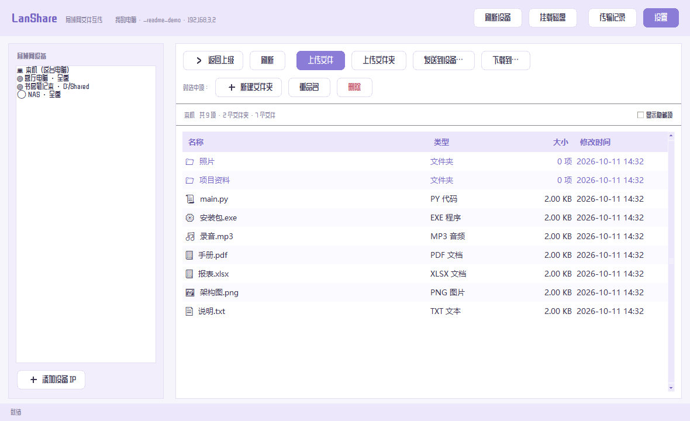

# LanShare · 局域网文件互传

<p align="center">
  <b>把家里、公司几台电脑之间的文件互传，做得像用同一台电脑一样简单。</b><br>
  原生桌面窗口 · 自动发现设备 · 断点续传 · 可挂载成网络驱动器 · 手机网页版
</p>

<p align="center">
  
  
  
  
  
  <a href="../../releases/latest"></a>
</p>

<p align="center">
  
</p>

---

## 这是什么

LanShare 是一个**零依赖**的局域网文件互传工具。双击 `LanShare.exe` 就有原生窗口，
左边列出局域网里的其它电脑，右边像资源管理器一样浏览文件——
选中就能下载、上传、或直接发给第三台电脑，全程不用配置、不用输命令。

| 你想要的 | LanShare 怎么做 |
| --- | --- |
| 几台电脑互传文件 | 打开就自动发现彼此，左边点名字即可浏览对方磁盘 |
| 不想每次都传 | 把对方磁盘**挂载**成「我的电脑」里的网络驱动器，当本地盘用 |
| 大文件传到一半断了 | 支持**断点续传**，重发时从断掉的位置继续 |
| 手机上也想拿文件 | 同一个 WiFi 下浏览器打开地址即可，网页版自适应手机 |
| 传几百个小文件 | 小文件批量打包，速度不塌方（见下方[性能](#性能)） |
| 开着窗口碍事 | 关窗口 = 缩到托盘后台运行，可设开机静默自启 |

```
        ┌───────────────────────────────────────────┐
        │   电脑 A（你坐在这台）                     │
        │   ┌─────────────┐                         │
        │   │ 桌面窗口     │  浏览 / 下载 / 发送      │
        │   └─────────────┘                         │
        └──────┬──────────────┬──────────────┬──────┘
               │              │              │
          ┌────▼────┐    ┌────▼────┐    ┌────▼────┐
          │ 电脑 B  │    │ 电脑 C  │    │ 手机    │
          │ 静默托盘│    │ 静默托盘│    │ 浏览器  │
          └─────────┘    └─────────┘    └─────────┘
               └──── B 和 C 之间也能直接传 ────┘
```

---

## 界面

### 主窗口

左边是设备列表，右边是文件区。文件按类型显示图标和类型名，文件夹有独立底色，
底部状态栏显示传输进度。


### 挂载磁盘

把别的电脑的某个磁盘挂成「我的电脑」里的网络驱动器，挂上之后双击就能直接浏览、
复制，和在本地一样。选对方电脑 → 选对方的盘 → 选本机盘符，一步到位。


### 提示气泡

所有提示都不用系统那种方头方脑的对话框，换成了圆角对话气泡，配表情图标和亲切文案。


---

## 快速开始

### 方式一：直接用打包好的 exe（推荐）

1. 打开 [**Releases 下载页**](../../releases/latest)，下载
   `LanShare-x.y.z-windows-x64.rar`
2. 解压后双击 `LanShare.exe`，出现主窗口即可用
3. 其它电脑同样操作一遍，左边就会自动出现对方

> 只有一台电脑也想试试？直接双击就行，可以浏览本机磁盘。
>
> 压缩包里除了主程序，还有 `放行防火墙.bat`（连不上时用）和
> `LanShare.py`（装了 Python 的机器可直接跑的单文件版）。

### 方式二：从源码运行

需要 Python 3.8+，**无需安装任何第三方库**：

```bash
python lanshare.py                    # 共享当前目录，端口 8765
python lanshare.py --root "D:\共享"   # 指定共享目录
python lanshare.py --whole-disk       # 开放全部磁盘
python lanshare.py --tray             # 静默启动，只留托盘图标
```

### 方式三：自己打包成 exe

```bash
python -m pip install pyinstaller
python build_exe.py      # 产出 dist/LanShare.exe
```

---

## 怎么用（30 秒）

1. **双击 `LanShare.exe`**，出现主窗口。
2. 左边默认选中「本机」，右边就是你的磁盘，点进去随便看。
3. 选中文件或文件夹后：
   - **下载到…** → 选一个保存位置
   - **上传文件 / 上传文件夹** → 传到当前目录
   - **发送到设备…** → 直接推给另一台电脑
4. 想看别的电脑的文件？在左边点它的名字。

**关掉窗口不会退出程序**，只是缩到右下角托盘。
想真正退出：托盘图标右键 →「退出 LanShare」。

---

## 部署到多台电脑

1. 把 `LanShare.exe` 拷到每台电脑（单文件即可，无需其它依赖）。
2. 每台都双击运行一次，确认能打开窗口。
3. 在每台上打开「**设置**」→ 勾选「**开机自动启动**」→ 保存。
   之后开机就会自动在托盘静默运行，不弹窗口。
4. 完事。以后坐在任意一台上，左边就能看到所有在线的电脑。

> **看不到别的电脑？**
> 1. 双击 `放行防火墙.bat`（会请求管理员权限），放行 TCP 8765 和 UDP 48899
> 2. 在「设置 - 网络和 Internet」里把网络类型改成「专用网络」
> 3. 还是看不到，就在左边点「**添加设备 IP**」手动填对方 IP

---

## 功能一览

| 功能 | 说明 |
| --- | --- |
| **原生桌面窗口** | tkinter 界面，不是网页；资源管理器式的文件列表和右键菜单 |
| **自动发现设备** | UDP 广播自动发现同一局域网内的其它节点，也可手动填 IP |
| **全盘访问** | 默认可浏览本机全部磁盘，不用事先指定共享哪个文件夹 |
| **多机互传** | 浏览任意电脑、下载、上传；支持 **B → C 直达**（不经过本机中转落盘） |
| **挂载为网络驱动器** | 基于 WebDAV，把对方磁盘挂到「我的电脑」里当本地盘用 |
| **断点续传** | 传输中断或程序重启后，重发会从已传字节继续；相同文件自动跳过 |
| **小文件加速** | 连接复用 + 批量打包，几百个零散小文件也不掉速 |
| **系统托盘** | 关窗口 = 缩到托盘，后台继续服务；右键可重开界面或退出 |
| **开机静默自启** | 设置里一键开关，开机自动在托盘运行 |
| **手机网页版** | 同一 WiFi 下浏览器打开 `http://电脑IP:8765/` 即可 |
| **路径安全** | 即使全盘开放，`../` 之类的越界访问仍会被拒绝 |

---

## 性能

局域网本身很快，慢通常不是因为带宽，而是"每个文件都要来回一趟"。
LanShare 针对这点做了两件事：

- **连接复用**：不再每个文件重新握手
- **小文件批量打包**：一批最多 128 个、不超过 8MB 的小文件合并成一次请求

本机回环实测（延迟极低，实际局域网中提升更明显）：

| 场景 | 改进前 | 改进后 |
| --- | --- | --- |
| 500 个 4KB 文件（推送） | 1.82 秒 | **0.25 秒** |
| 500 个 4KB 文件（拉取） | 1.82 秒 | **0.25 秒** |
| 2000 个 8KB 文件（15.6 MB） | — | **1.0 秒（约 15 MB/s）** |
| 单个大文件（40 MB） | 158 MB/s | 158 MB/s（不退化） |

> 上表为 Windows 本机回环测试结果，仅用于对比相对提升；真实局域网取决于
> 网卡、路由器和磁盘速度。

---

## 挂载磁盘说明

挂载基于 Windows 自带的 **WebDAV 客户端**（WebClient 服务），不需要安装任何驱动。

**用法**：主界面点「**挂载磁盘**」→ 选对方电脑 → 选对方的盘 → 选本机盘符 → 确定。

几个要知道的点：

- **需要管理员权限**：挂载网络驱动器是 Windows 的系统限制，会弹一次 UAC，点「是」即可
- **要挂具体某个盘**：全盘模式下请挂 `C`、`D` 这样的具体磁盘。
  挂「此电脑」这个虚拟根在 Windows 上打不开，属于系统限制
- **速度不如自带的传输**：WebDAV 走系统客户端，大量小文件会慢一些。
  它的价值在于**方便**——能直接用资源管理器浏览、拖拽、用别的软件打开对方文件；
  真要批量传文件，还是用「发送到设备…」更快
- 挂载时会自动放宽 WebDAV 的两个默认限制（单文件 47.7MB、Basic 认证仅限 SSL）

---

## 项目结构

```
LanShare/
├── lanshare.py          # 后端：HTTP 服务、设备发现、传输引擎、WebDAV
├── lanshare_gui.py      # 桌面界面（tkinter）+ 托盘 + 气泡弹窗 + 圆角按钮
├── lanshare_ui.py       # 手机网页版界面（内嵌 HTML/CSS/JS）
├── lanshare_icon.py     # 纯 Python 生成程序图标
├── build_exe.py         # 打包成单文件 exe
├── build_single.py      # 打包成单文件 Python 脚本
├── assets/              # 随程序分发的字体（OFL 许可，可免费商用）
├── demo/                # 演示用共享目录
├── test_*.py            # 自动化测试
└── ui_test*.mjs         # 网页版界面测试
```

### 技术栈

- **后端**：Python 标准库（`http.server`、`socket`、`tkinter`），零第三方依赖
- **设备发现**：UDP 广播
- **挂载**：服务端实现 WebDAV（PROPFIND / PUT / MKCOL / MOVE / LOCK…），
  客户端调用系统 `net use`
- **前端**：内嵌 HTML/CSS/JS，无框架

---

## 测试

项目自带一套自动化测试，会真实启动多个节点进程互相传文件：

```bash
python test_lanshare.py   # 后端：浏览/上传/下载/断点续传/推送/拉取/鉴权/路径安全（112 项）
python test_gui.py        # 桌面界面：下载/上传/托盘/自启（26 项）
python test_relay.py      # 多机集中管理，含 B→C 直传（16 项）
python test_cpu.py        # CPU 占用回归（6 项）
```

---

## 常见问题

<details>
<summary><b>另一台电脑看不到我的设备</b></summary>

1. 双击 `放行防火墙.bat` 放行端口（需要管理员权限）
2. 把网络类型改成「专用网络」
3. 点左侧「添加设备 IP」手动填写对方 IP
4. 确认两台在同一个网段；部分路由器/访客 WiFi 开了"客户端隔离"，会互相看不见
</details>

<details>
<summary><b>双击 exe 报 "Could not create temporary directory"</b></summary>

程序需要把自身解压到临时目录才能启动。请把 `LanShare.exe` 放到一个普通路径
（例如 `D:\LanShare\`）再运行，不要放在权限受限或被安全软件全盘拦截的目录里。
</details>

<details>
<summary><b>挂载后提示连接超时（WinError 10060）</b></summary>

这是网络层被拦住了，不是程序问题。请在**被访问的那台电脑**上放行防火墙端口：

```
netsh advfirewall firewall add rule name="LanShare TCP 8765" dir=in ^
  action=allow protocol=TCP localport=8765 profile=private,domain
```

或者直接双击 `放行防火墙.bat`。
</details>

<details>
<summary><b>挂载显示成功，但打开盘符报"找不到网络路径"</b></summary>

检查挂的是不是具体某个磁盘。Windows 的 WebDAV 客户端无法浏览"此电脑"这种虚拟根，
请在挂载对话框里选 `C`、`D` 这样的具体盘。
</details>

---

## 安全说明

LanShare 面向**可信局域网**场景，默认不设密码、不加密。

- 如需密码：启动时加 `--key 你的密码`，其它设备需填写相同密码
- 如需 HTTPS：加 `--https`（需要 `cryptography` 生成自签证书）
- 共享范围可只开放指定目录（`--root` + `--shared-only`），而不是全盘

**不要在公网或不可信网络直接暴露**，请配合防火墙和访问密码使用。

---

## 版本历史

| 版本 | 主要变化 |
| --- | --- |
| **1.5.0** | 新增「挂载磁盘」：把对方磁盘挂成网络驱动器（WebDAV），可指定盘符与对方磁盘 |
| **1.4.0** | 圆角胶囊按钮；主字体换成更清晰的站酷庆科黄油体，密集数据用雅黑 |
| **1.3.0** | 可爱版：圆润中文字体 + 圆角对话气泡弹窗 + 亲切文案 |
| **1.2.0** | 零散小文件大幅提速：连接复用 + 小文件批量打包 |
| **1.1.0** | 界面改版：淡紫主题、卡片布局、类型列与图标 |
| **1.0.0** | 首个版本：文件浏览、互传、设备发现、断点续传、托盘、网页版 |

---

## 协议与致谢

本项目以 **MIT License** 开源，详见 [LICENSE](LICENSE)。

内置字体 **站酷庆科黄油体 / 站酷快乐体** 来自
[Google Fonts](https://fonts.google.com/)，遵循
[SIL Open Font License 1.1](assets/OFL.txt)，可免费商用。

> 随程序分发的字体文件版权归原作者（站酷 / ZCOOL）所有，
> 仅按 OFL 许可随本项目一起分发。

---

<p align="center">
  <sub>如果这个项目帮到了你，欢迎点个 ⭐ Star · 有问题请提 Issue</sub>
</p>
